<div align="center">


# Warranty

### L'agent IA qui transforme les garanties oubliées en économies.

Warranty repère l'équipement en panne, retrouve sa facture, vérifie la garantie
et ouvre lui-même le dossier chez le fabricant. Vous gardez toujours la décision.

[](https://github.com/barrage75/WarrantyPilot/actions/workflows/ci.yml)


[**Vidéo de démo**](#-vidéo-de-démo) · [**Lancer la démo**](#-lancer-la-démo-en-5-minutes) · [Fonctionnement](#-comment-ça-marche) · [Captures](#-aperçu) · [Architecture](#-architecture) · [Documentation](#-documentation)

<br/>

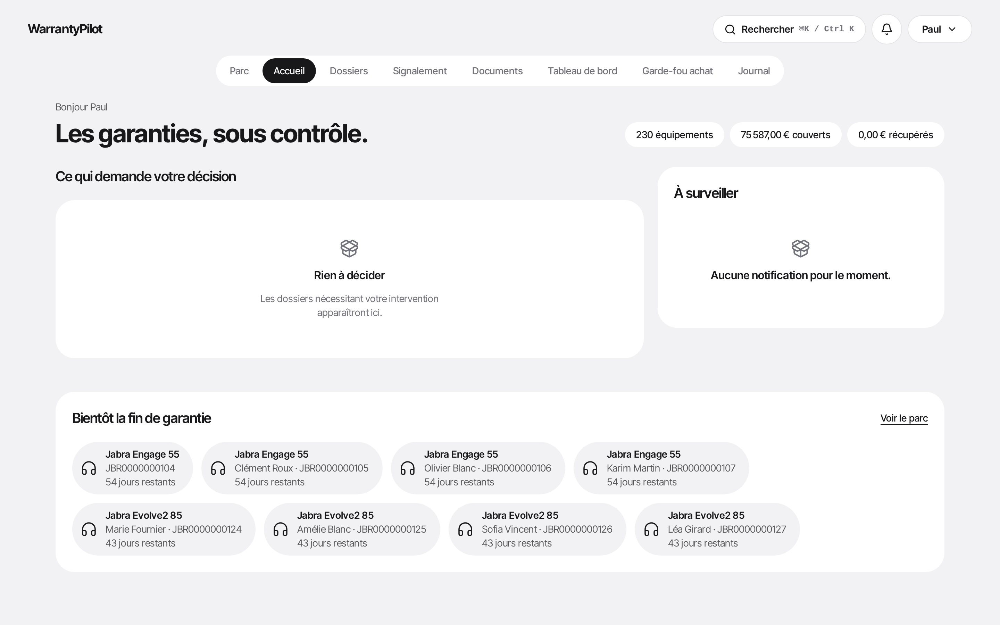

</div>

---

## 🎬 Vidéo de démo

<div align="center">

<a href="docs/demo/warranty-demo-en.mp4">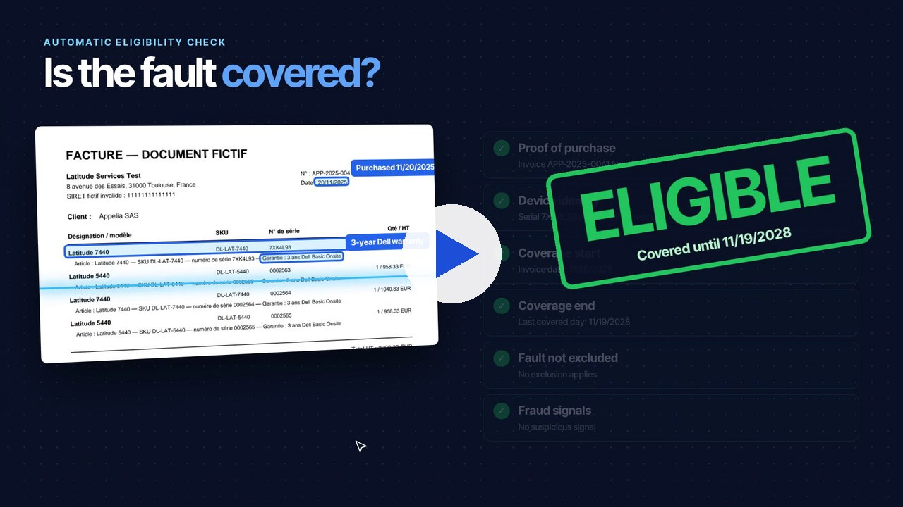</a>

**[▶ Regarder la vidéo (1 min 09, en anglais, voix off)](docs/demo/warranty-demo-en.mp4)**

</div>

Une salariée signale une panne en une phrase. L'agent identifie le PC, vérifie sur la facture que la panne est couverte, puis, après validation du responsable informatique, dépose seul la demande sur le portail Dell et suit le dossier jusqu'à sa résolution. Ce sont de vrais enregistrements de l'application, en données fictives ; le portail Dell est une reproduction locale et la clôture côté Dell est simulée.

---

## 💡 Le problème

Une entreprise rachète chaque année du matériel encore sous garantie : la facture est
introuvable, la durée de garantie est inconnue, et la démarche chez le fabricant est trop
longue. **Warranty s'occupe de tout le travail administratif**, de la facture jusqu'au
dossier résolu.

## ✨ Ce que fait Warranty

| | Fonction | En pratique |
|---|---|---|
| 📄 | **Lit les factures** | PDF et Factur-X. Dates, numéros de série et durées de garantie extraits, chaque information gardant sa preuve. |
| ⚖️ | **Calcule la couverture** | Un moteur de règles déterministe donne un verdict par équipement : couvert, probable, non couvert, hors garantie ou à vérifier. |
| 💬 | **Reçoit les pannes** | Par chat ou par e-mail : « Mon casque Jabra ne marche plus » suffit. L'agent identifie l'équipement et sa facture. |
| 🤖 | **Agit chez le fabricant** | Un navigateur automatisé remplit le formulaire du portail fabricant, puis suit le dossier jusqu'à sa résolution. |
| ✋ | **Vous laisse décider** | Rien ne part sans politique d'envoi claire ou sans votre validation, avec 5 secondes pour annuler. |
| 🛒 | **Garde-fou d'achat** | Il vous prévient avant de racheter un équipement encore sous garantie. |
| 🔏 | **Journal infalsifiable** | Chaque action est signée (HMAC) et ancrée : la trace complète est vérifiable à tout moment. |

## 🧭 Comment ça marche

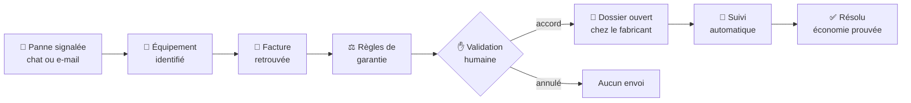

## 🖼️ Aperçu

<table>
  <tr>
    <td width="50%">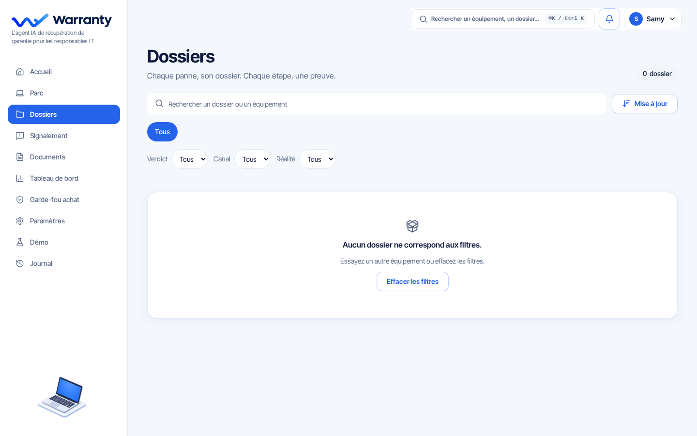<p align="center"><b>Dossiers</b> : le suivi des demandes de garantie</p></td>
    <td width="50%">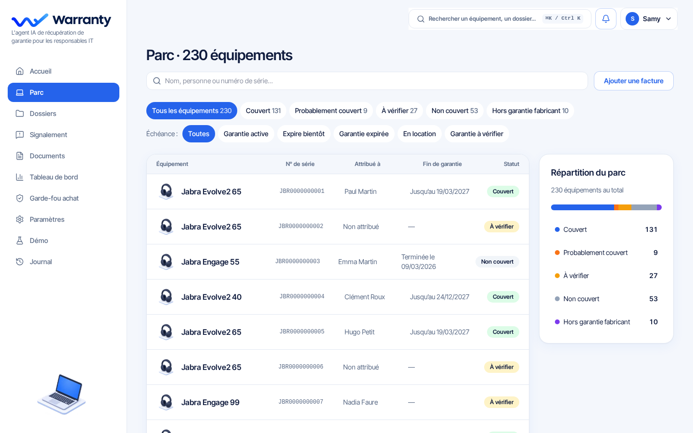<p align="center"><b>Parc</b> : la garantie de chaque équipement</p></td>
  </tr>
  <tr>
    <td width="50%">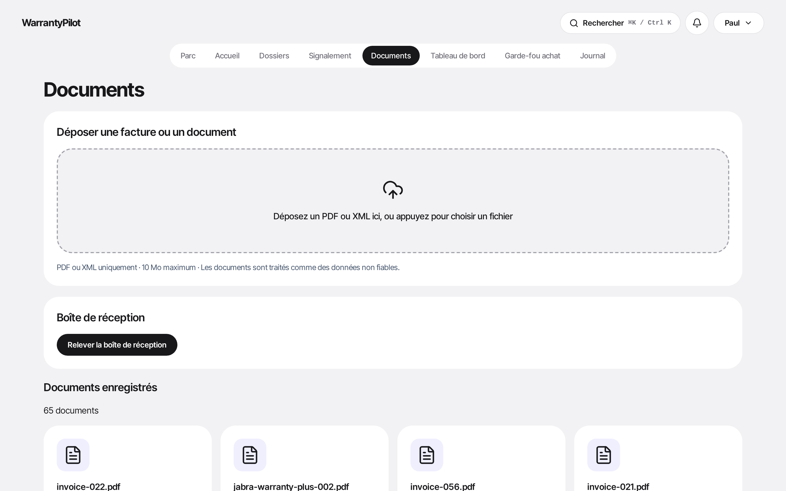<p align="center"><b>Documents</b> : factures déposées ou reçues par e-mail</p></td>
    <td width="50%">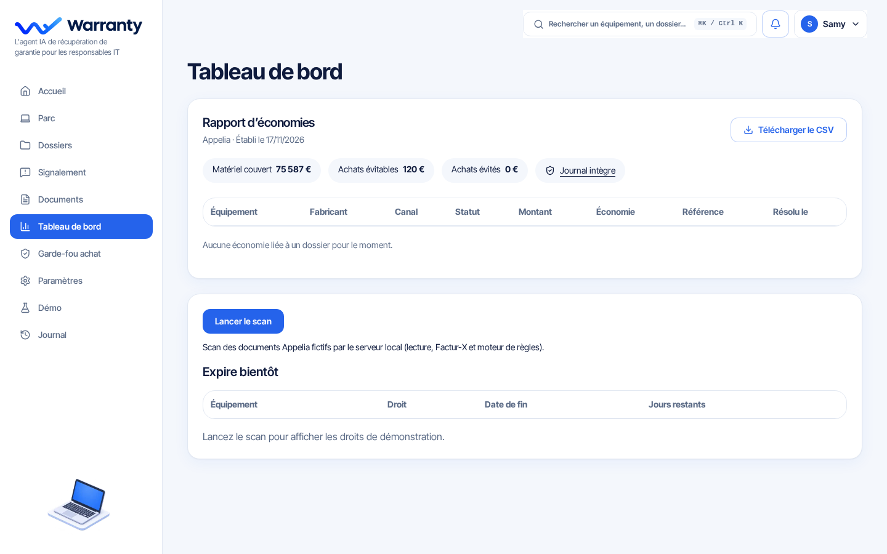<p align="center"><b>Tableau de bord</b> : activité et économies suivies</p></td>
  </tr>
  <tr>
    <td width="50%">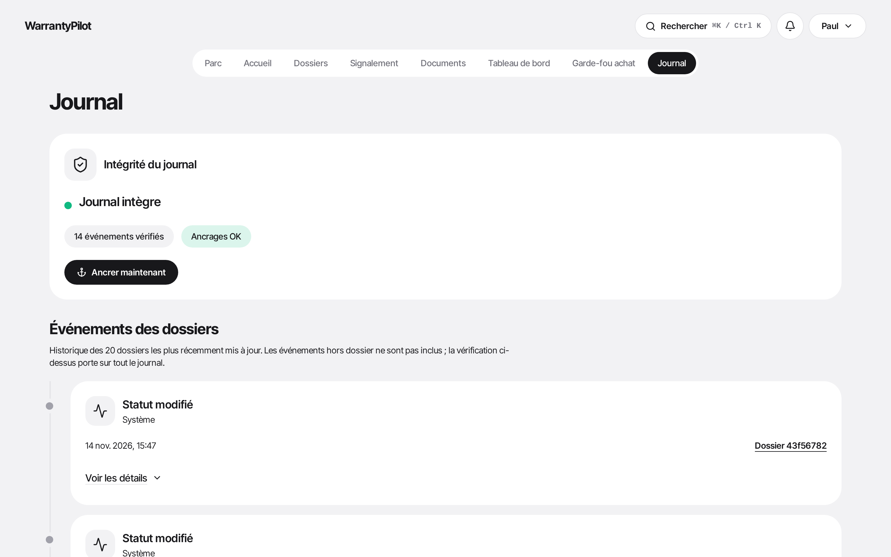<p align="center"><b>Journal</b> : chaque action vérifiable</p></td>
    <td width="50%">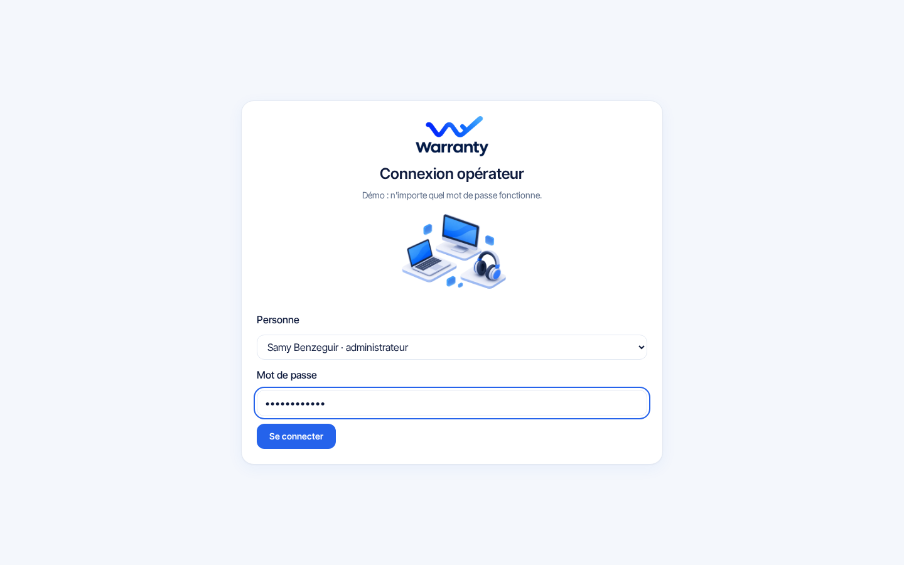<p align="center"><b>Connexion</b> : une entrée simple vers la démo</p></td>
  </tr>
</table>

<p align="center">
  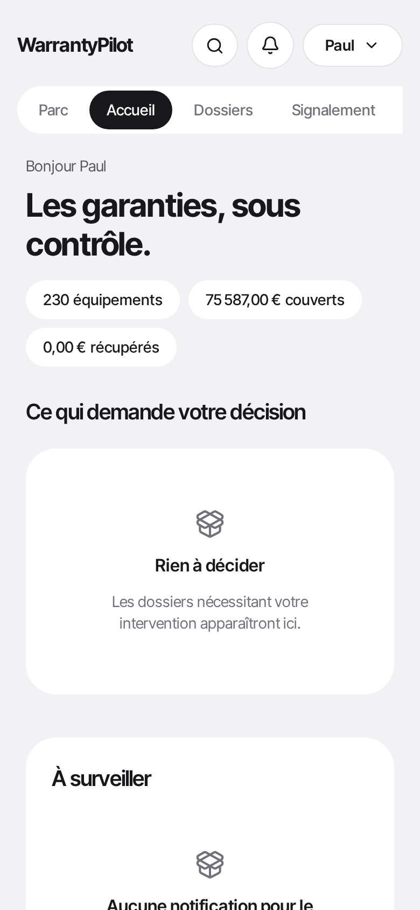<br/>
  <sub>Interface Bento, en français et en anglais, sur ordinateur et sur mobile, avec recherche <kbd>⌘K</kbd>.</sub>
</p>

## 🚀 Lancer la démo en 5 minutes

> Tout tourne **sur votre ordinateur**, avec des données fictives (l'entreprise Appelia).
> Le portail Dell est une **reproduction locale** : rien n'est envoyé à un vrai fabricant,
> et aucun vrai e-mail ne part.

### Windows

1. [Téléchargez le ZIP du projet](https://github.com/barrage75/WarrantyPilot/archive/refs/heads/main.zip)
   et **extrayez-le** (pas besoin de Git).
2. Installez **uv**, qui gère Python pour vous. Dans PowerShell :
   ```powershell
   powershell -ExecutionPolicy ByPass -c "irm https://astral.sh/uv/install.ps1 | iex"
   ```
3. Installez **[Node.js LTS](https://nodejs.org/)**, puis fermez et rouvrez vos terminaux.
4. Double-cliquez sur **`demo.cmd`**.

### macOS / Linux

Installez [uv](https://docs.astral.sh/uv/) et Node.js LTS, puis :

```sh
sh demo.sh
```

### Ensuite

Le premier lancement télécharge Python 3.12, les dépendances et Chromium (2 à 5 minutes).
Les suivants prennent quelques secondes. Le navigateur s'ouvre seul sur
**http://127.0.0.1:5173**.

| Quoi | Détail |
|---|---|
| 👤 **Connexion** | Choisir **Samy Benzeguir** (administrateur) ; n'importe quel mot de passe fonctionne en démo. |
| 🎬 **Scénario** | [`docs/demo/SCRIPT_3MIN.md`](docs/demo/SCRIPT_3MIN.md) |
| ⏹️ **Arrêter** | <kbd>Ctrl</kbd>+<kbd>C</kbd> dans la console (répondez `O` si Windows le demande) |

**Options du lanceur**

| Commande | Effet |
|---|---|
| `demo.cmd --reset` / `sh demo.sh --reset` | Remet la démo à zéro (base et portail Dell local) |
| `demo.cmd advance` / `sh demo.sh advance` | Fait avancer le dossier Dell local jusqu'à « Résolu », dans un second terminal |
| `--skip-setup` | Saute installations et migrations, après une première préparation réussie |
| `--no-browser` | N'ouvre pas le navigateur automatiquement |

<details>
<summary><b>🛠️ En cas de souci</b></summary>

- **Port occupé** (8001, 5173, 2525 ou 8100) : arrêtez l'ancienne démo ou l'application
  qui utilise ce port. Ne lancez pas `make dev` en parallèle.
- **Antivirus ou pare-feu** : autorisez Python et Node pour cette démo locale, sans
  désactiver votre protection ni ouvrir de port sur Internet.
- **Premier lancement long** : laissez les téléchargements se terminer. En cas d'erreur,
  consultez `runtime/logs/` (la fenêtre Windows reste ouverte).
- **Outil introuvable** : rouvrez le terminal après l'installation. Pour Python :
  `uv python install 3.12`. Sur Linux, si Chromium signale une bibliothèque absente :
  `uv run --project backend playwright install-deps chromium`.

</details>

## 🧪 Réel, reproduit ou simulé ?

La démo affiche un badge sur chaque élément, pour ne jamais présenter un faux succès.

| Badge | Signification |
|---|---|
| 🟢 **Réel** | Exécuté par le code, sans service externe : lecture des factures, règles, validation, journal. |
| 🟠 **Reproduction locale** | Action réellement exécutée vers une cible locale fictive : serveur e-mail local, copie du portail Dell. |
| ⚪ **Simulé** | Donnée fictive : l'entreprise Appelia, le colis de remplacement. |

## 🏗️ Architecture

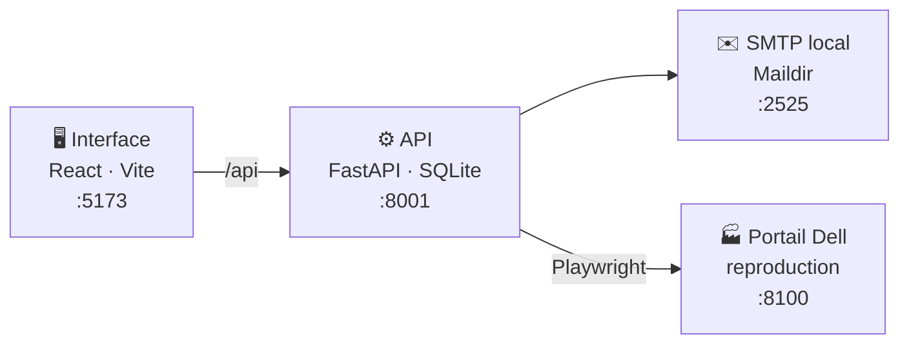

Les quatre services écoutent uniquement sur `127.0.0.1`.

| Couche | Technologies |
|---|---|
| **Interface** | React 19, TypeScript, Vite, Tailwind CSS v4, TanStack Query, React Router, i18next, cmdk, Motion, Sonner, lucide-react |
| **Serveur** | Python 3.12, FastAPI, SQLAlchemy, Pydantic, Alembic, SQLite |
| **Lecture des documents** | PDF et Factur-X, avec la provenance de chaque information |
| **Action navigateur** | Playwright (Chromium) vers la reproduction locale du portail Dell |
| **Outillage** | uv, npm, pytest, Vitest, Playwright, GitHub Actions |

<details>
<summary><b>📁 Structure du dépôt</b></summary>

```text
backend/          API FastAPI, règles, lecture des documents, actions, suivi
  app/ingestion/    lecture PDF et Factur-X
  app/rules/        moteur de règles de garantie
  app/actions/      e-mail et navigateur
  app/followup/     suivi des dossiers fabricant
  app/purchase_guard/  garde-fou d'achat
frontend/         interface React (Bento)
repro/dell/       reproduction locale du portail Dell
data/appelia/     données fictives de démonstration
scripts/demo.py   lanceur de démo multiplateforme
docs/             architecture, API, sécurité, démo, design
```

</details>

## 👩‍💻 Développement

```sh
cp .env.example .env
uv python install 3.12
make setup
make dev          # API sur 127.0.0.1:8001, interface sur 127.0.0.1:5173
```

```sh
make test         # tests serveur
make lint
make typecheck
make frontend-build
make openapi
make reset        # API lancée
make preflight    # API lancée
```

Remplacez `WP_JOURNAL_ANCHOR_KEY` dans `.env` avant toute utilisation au-delà des données
fictives locales. Ne committez jamais `.env`.

## 📚 Documentation

| Document | Contenu |
|---|---|
| [Architecture](docs/ARCHITECTURE.md) | Composants et frontières de confiance |
| [API](docs/API_DOCUMENTATION.md) | Points d'entrée (Swagger sur `/docs`) |
| [Base de données](docs/DATABASE.md) | Schéma et migrations |
| [Sécurité](docs/SECURITY.md) · [Audit](docs/audit/AUDIT_SECURITE.md) | Modèle de menace et audit |
| [Design system](docs/design/DESIGN_SYSTEM.md) | Composants Bento |
| [Démo](docs/demo/SCRIPT_3MIN.md) · [Runbook](docs/demo/RUNBOOK.md) · [Pitch](docs/demo/PITCH.md) | Préparer une présentation |
| [Contribuer](docs/CONTRIBUTING.md) · [Propriété](OWNERSHIP.md) · [Décisions](DECISIONS.md) · [Changelog](CHANGELOG.md) | Travailler sur le projet |

## 🗺️ Prochaines étapes

- [ ] Brancher une vraie boîte mail (Gmail)
- [ ] Connecter un premier vrai portail fabricant, en mode test
- [ ] Lecture OCR des factures scannées
- [ ] Import des factures d'une vraie entreprise

---

<div align="center">
<sub>Warranty · démonstration locale avec des données fictives · aucun fabricant réel n'est contacté</sub>
</div>
